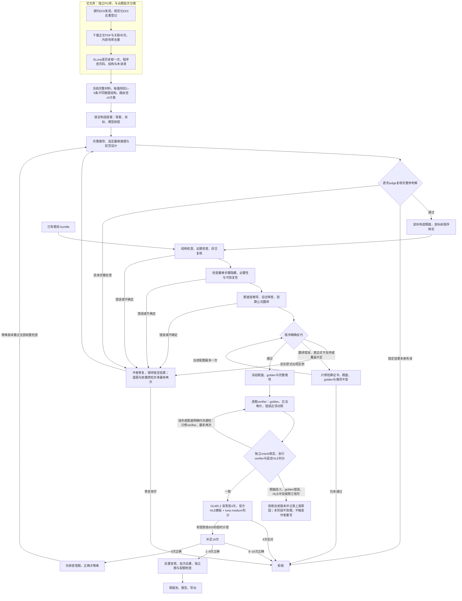

# RST → HLE-style Question Factory

从数学/理论物理论文构造可追溯题目：预建论文库，从候选答案与完整推导出发，挖空最难推理，通过独立科学检查后测量难度。按用户最新口径，论文作为启发，允许自洽的新构造，来源逐字/逐结论一致性只记提示；实际题面、推导和golden必须一致。目前仍是实验管线，尚未证明能稳定生产HLE Diamond题目。

当前模型：作者和审查为gpt-6-luna，解题为GLM5.2无工具、600秒墙钟；官方HLE模板由gpt-6-luna medium判分。首4次全对直接拒绝，出现错答或解题墙钟超时才补至16次；1–8/16进入后置复核，0/16先排错再降难，不执行加难。

新材料流程为“元数据规范化DOI并去重登记 → 下载原PDF和补充材料 → 6Luna直接逐页读取一次 → PG索引与内容寻址库 → 出题时读取冻结论文版本”。不再对全文追加第二个模型逐页验收；来源疑点保留原页核对，科学审查仍在出题阶段执行。下载、转录完成与可用于出题分别统计。完整独立材料达到批次指定数量后可自动规划每篇1–5条不同推理结构（当前首20份试产，解析到50份停止新增请求），通过原科学质检管线试产。各阶段费用包含拒绝、失败与重试，缓存归原支付run计费。

## 入口

- [文档导航](docs/README.md)：按ClawGym的文档职责划分组织。
- [架构与模块归属](docs/synthesis-architecture.md)、[验证方法与个人VM](docs/local-validation.md)。
- [论文下载](docs/pdf-paper-library.md)、[直接读取入库](docs/paper-library-ingestion.md)、[读取上限与20份试产](docs/reader-limits.md)、[数据库](docs/database.md)。
- [出题设计](docs/question-design.md)、[科学检查](docs/consistency.md)、[verifier对抗](docs/verifier-adversary.md)。
- [来源启发与自洽验收](docs/source-fidelity.md)：新论文库默认`configs/library-source-inspired.toml`；严格模式保留给历史配置。
- [实验协议](docs/theory-experiment.md)、[历史结果](docs/validation/README.md)、[验收](docs/acceptance.md)。

## 本地开始

需要Python3.11+和uv；PDF读取需要Poppler。真实密钥不提交Git。

```bash
uv sync --frozen --python 3.12
uv run ruff check src tests scripts
uv run pytest -q
uv run diamond doctor

# 自备题目质检；样例很简单，预期因太易拒绝。
uv run diamond qc examples/paper-qc.jsonl --run-id qc-first --mode pilot
uv run diamond report
```

个人VM正式运行使用独立PostgreSQL及对象目录；首次或升级显式运行`diamond db-init`，当前包含004论文库与005元数据身份迁移。离线测试可以用SQLite，理论无工具题无需Harbor。论文批量下载和读取命令见[论文库](docs/paper-library-ingestion.md)。

## 模型与判分

- Solver：`glm-5.2`，16 个独立请求，默认 temperature=1.0、top_p=0.95；只看题面，以 600 秒墙钟时间为限，重试包含在内，不发送输出 token 上限。
- Judge：`gpt-6-luna`，`reasoning_effort=medium`；使用官方 HLE 模板和输出字段，包含最终答案抽取、语义比较与数值小误差口径。
- Consistency：单独的 `gpt-6-luna high` 角色，先只看题面独立推导，再核对题面/金标，另一次隔离调用检查验算公式的翻译；程序执行精确反代、合法参数点和输出覆盖检查。三次独立请求，不读取历史通过率；失败、不确定或计算检查未覆盖都阻止采样。100条新理论实验另启用题面生成前的参考蓝图复核。详见 [出题设计](docs/question-design.md)与[前置自洽审查](docs/consistency.md)。
- 模板固定于官方仓库提交 `22ed3074b1e7b134bcbc09028d0ba320839b0655`，来源和哈希见 [configs/judge-contract.json](configs/judge-contract.json)。官方没有给出统一数值 epsilon，本项目也没有另加固定容差。
- 当前只支持无工具评估；HLE-Diamond 另有受控搜索与离线代码模式，规则、官方 600 秒客户端设置与用户选择的硬限时之间的区别见 [docs/calibration.md](docs/calibration.md)。
- 保存模型请求名、响应实际模型名、参数、模板哈希、16 个回答与判分、usage。解题达到600秒按用户规则计错且单列；其他调用失败、截断、JSON错误或超预算不当作答错。
- 网关需支持兼容的 `/v1/chat/completions`、JSON object 输出和 reasoning_effort。实际模型名不符会失败；如网关使用有证据的别名，可显式配置 `accepted_response_models`。

各角色配置分别冻结。理论试产的作者、综合复核和consistency使用gpt-6-luna的独立调用；历史配置保留自己的模型。分工与盲推导能减少金标锚定，不能消除同模型相关性错误；模型审查通过不等价于数学证明或专家确认。

## 出题和项目边界



首题构造可参考四类目标：逆向求全体参数/结构、自行判分支、完整参数区域与边界、识别定理适用性并处理例外。目标必须在锁定golden前确定，随后从完整推导回溯并隐藏最难的可恢复桥梁，保留充分定义与必要前提；详见[挖空设计](docs/bottleneck-masking.md)。这不是采样后的加难分支。


生产规则与参数见[实验协议](docs/theory-experiment.md)，恢复与请求收据见[恢复合同](docs/resilience.md)。同论文多题必须有不同推理结构；通过全部前置检查才购买GLM难度样本。

`pilot`通过只记screened；`production`还要求后置复核、批次去重与配额。飞书私有需求保存于本地，不提交公开仓库；61子类共2000道是需求目标，当前没有完成交付。按用户要求暂不做旧训练集和完整官方评测集去重，批次内去重保留。

当前为单写者内部并发的实验实现，未接多worker管理服务，不执行模型生成代码，不提供任意数学命题的形式化证明器。原PDF、私有需求、密钥、原始题库与完整轨迹不提交Git；公开内容为代码、脱敏配置、文档和统计。[RST有效性评估](docs/rst-assessment.md)及[历史批次](docs/validation/README.md)保留真实失败与未覆盖范围。
