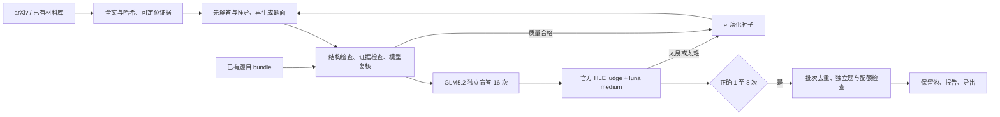

# RST → HLE-style Question Factory

从论文/预备材料库构造可追溯题目，按需求进行质检，再逐步接通递归演化。**当前优先交付质检模块，递归生成器为实验实现。** 本项目并非官方 HLE 项目，也不宣称产物已达到 HLE Diamond 质量。

已实现：来源导入和 arXiv 全文抓取、题目数据契约、来源引文校验、独立复核调用、GLM5.2 的 16 次盲答、官方 HLE judge 模板、1–8/16 筛选、批次语义去重、分类配额、谱系、请求预算、缓存续跑、报告和导出。

需求原文通过 `feishu-cli wiki export` 保存于本地 `outputs/requirements-feishu.md`，未提交到公开仓库。配置包含文档中的 61 个采购子类，合计 2,000 道；沿用原分类，不重算已注明待修正的跨大类归属。原文 120 道示例仅进入本地排除库，不进入生成提示或交付。

用户在 2026-10-23 明确：先跳过旧训练集和完整官方评测集查重；判分口径采用官方 HLE。批次内去重仍执行，报告如实标明外部查重范围。



## 先跑质检

需要 Python 3.11+ 和 [uv](https://docs.astral.sh/uv/)。从仓库根目录执行：

```bash
uv sync --frozen --python 3.12
uv run pytest -q
uv run diamond doctor

# 使用你自己的网关；不得把真实密钥写进 Git
export NEW_API_BASE_URL=https://your-gateway.example/v1
export NEW_API_KEY=...

# 抓一篇实际论文；也可用 ingest 导入预备材料库
uv run diamond crawl --ids 1706.03762v7 --limit 1

# 公开样例为新编的简单参数计数题，仅测试链路，预期会因太易被过滤
uv run diamond qc examples/paper-qc.jsonl --run-id qc-first --mode pilot
uv run diamond report
```

`pilot` 通过筛选也只记作 `screened`，不计入采购交付量。`production` 通过所有机器质检和独立题/配额门槛后记作 `accepted`：

```bash
uv run diamond --config configs/production.toml qc work/my-submissions.jsonl \
  --run-id batch-001 --mode production
uv run diamond export --output outputs/batch-001.jsonl
# 只有每个子类分别补足配额，整批导出才会通过此项检查
uv run diamond export --require-complete --output outputs/all-2000.jsonl
```

自备题目格式见 [examples/paper-qc.jsonl](examples/paper-qc.jsonl)。每行包含 `id`、`item`、`solution`，不接受外部提供的分数/审计通过标志。用 `uv run diamond schema` 生成完整 JSON Schema。材料库格式见 [docs/data-contract.md](docs/data-contract.md)。

## 模型与判分

- Solver：`glm-5.2`，16 个独立请求，默认 temperature=1.0、top_p=0.95；只看题面，以 600 秒墙钟时间为限，重试包含在内，不发送输出 token 上限。
- Judge：`gpt-6-luna`，`reasoning_effort=medium`；使用官方 HLE 模板和输出字段，包含最终答案抽取、语义比较与数值小误差口径。
- 模板固定于官方仓库提交 `22ed3074b1e7b134bcbc09028d0ba320839b0655`，来源和哈希见 [configs/judge-contract.json](configs/judge-contract.json)。官方没有给出统一数值 epsilon，本项目也没有另加固定容差。
- 当前只支持无工具评估；HLE-Diamond 另有受控搜索与离线代码模式，规则、官方 600 秒客户端设置与用户选择的硬限时之间的区别见 [docs/calibration.md](docs/calibration.md)。
- 保存模型请求名、响应实际模型名、参数、模板哈希、16 个回答与判分、usage。不会把调用失败、截断、JSON 错误或超预算当作答错。
- 网关需支持兼容的 `/v1/chat/completions`、JSON object 输出和 reasoning_effort。实际模型名不符会失败；如网关使用有证据的别名，可显式配置 `accepted_response_models`。

当前 generator/auditor 默认使用同一模型的分离调用，只能减少上下文泄漏，不能消除同模型相关性错误。模型复核和引文存在性都不等价于学科正确性的证明。

## 递归与个人 VM

实验递归入口：

```bash
uv run diamond run --subtopic 人工智能与机器学习 --run-id evolve-first --mode pilot
```

顺序为解答蓝图 → 题面 → 复核 → 难度测量 → 去重/保留。`max_rounds`、修复次数、每来源候选数和请求预算均可配置。只有质量合格的题能成为父题；0/16 或 9–16/16 不交付，但可分别尝试降难度或升难度。默认每条根谱系最多计 1 道，防止同材料近似变体凑量。

在已有 SSH VM 上部署仓库、执行 `uv sync --frozen`，可从本机用下面的入口转发已有 API 环境变量（通过加密 SSH 标准输入，不写到命令参数或磁盘）：

```bash
python3 scripts/vm_run.py --host YOUR_SSH_ALIAS --directory ~/Developer/rst-hle \
  -- diamond qc examples/paper-qc.jsonl --run-id vm-smoke --mode pilot
```

同一个数据库只允许一个写入进程；16 次模型请求内部并发。复用原 run-id 可续跑，配置/提示/材料/代码变更需新 run-id。预算按**实际 HTTP 尝试**计数，含失败和重试；不是费用上限。所有请求 token 限额可配置，未配置价格时不虚构美元成本。

数据库已提供 **PostgreSQL + 独立文件产物库**，参考既有 ClawGym 的状态/产物分工。个人 VM 使用独立实例；离线测试保留 SQLite。详见 [数据库部署与 ClawGym 对照](docs/database.md)。首次显式运行 `diamond db-init`，普通启动只校验结构；GitHub CI 使用独立 PostgreSQL 覆盖真实读写、预算原子性与租约隔离。

## 项目边界

这是 QC 优先的 MVP：已实现数据库队列 repository，尚未接管理 API 和多 worker 调度；未提供任意学科的可执行证明器、未证明递归能提升跨学科独立合格率、未完成 2,000 道生产。自动抓取目前实现 arXiv；音乐、棋类、影视、历史等可先导入规则、谱文、原始文献和其他文本材料。源码不执行模型生成的代码。

试验设计与 RST 的有效性边界见 [docs/rst-assessment.md](docs/rst-assessment.md)，验收条目见 [docs/acceptance.md](docs/acceptance.md)，真实 VM 试跑结果见 [docs/validation.md](docs/validation.md)。来源原文、密钥、题库、完整回答轨迹和运行数据库默认均被 Git 忽略；仅代码/配置与脱敏统计进入公开仓库。

原始 HLE 参考题的并发难度校准入口见 [docs/calibration.md](docs/calibration.md)。用户已将判分模型更新为 gpt-6-luna medium。

2026-10-23 的八领域限时校准结果见 [docs/calibration-results-2026-10-23.md](docs/calibration-results-2026-10-23.md)。
