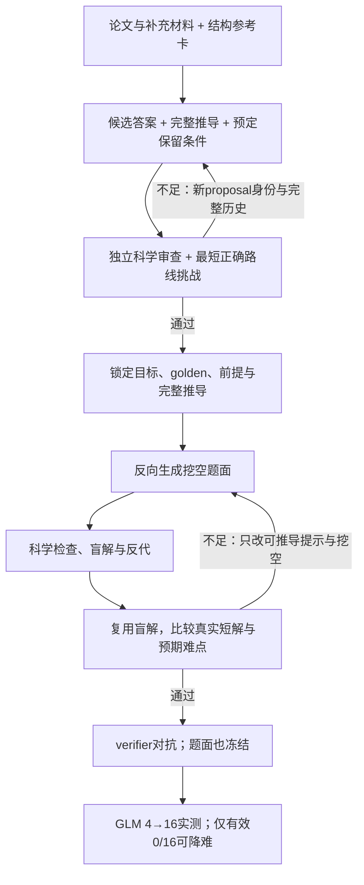

# 首题采样前的两阶段难度对抗

2026-10-25用户授权：新题难度不足时继续增强，目标锁定前和实际题面后的两个关口都接入对抗。每处初稿加最多两次修订；这是尝试上限，不是难度分数或费用硬上限。作者与审查沿用6Luna独立上下文，不提高模型规格。

## 第一关：锁定前的构造

DifficultyProposal返回候选结果和完整证明草稿，不生成最终题面。临时golden、目标与模型前提在独立科学和难度审查通过后才正式选定。每版有独立proposal_id和parent_proposal_id，保留完整旧稿、反馈、请求ID和真实模型；改变答案不是原地修复旧金标。

先逐条复核完整证明，再从声明的保留输入寻找最短正确路线，比较参考卡中的表示发现、必要依赖、例外完整性及下游负担。无合适材料可以unavailable。明确too_easy时反馈作者提出更强的新构造；科学错误先修，不得算难度收益；不确定单列unverified停止，不据此加难。最多三个提案，用尽拒绝，不进入GLM。

## 第二关：实际题面与盲解

先完成原综合审查、挖空检查、独立盲解、自洽与反代，再用已保存的盲解做难度挑战，不重买同一盲解。检查实际正确路线是否仍需要作者声称的桥梁，以及该桥梁是否有实质负担。

明确too_easy时，作者仅输出新question、隐藏步骤编号与可恢复性说明。程序保留目标、golden、完整证明、模型前提和输出合同，只改题面提示。可以隐去可推出的辅助量、表示、分支或区间，不能删除定义、独立规律、量词、平均/计数口径。固定结果仍然简单就最终拒绝，不能暗增子问或换答案。

每次新题面重新完成综合审查、挖空、盲解、自洽和反代。旧题与旧检查保存在DifficultyQuestionRound。新题科学检查失败就终止当前版本并返回问题，不当“更难”，不回外层整包重写清掉历史。verifier开始或已有答卷/超时收据后，不允许进入此循环。

后续0/16降难子题继承根题的构造来源，审查实际新题面；若偏浅直接拒绝，不再加难。旧首4/4和完整9–16/16继续关闭，绝不重买GLM。

## 两份结构卡

configs/difficulty-reference-cards.json不含原题全文、原公式或原金标：

- 数学：变换闭合、不同方法重建、约分/例外完整性、紧凑不变量。旧观察8正确/14有效，2截断，未完整验收；重数口径不作为难点。
- 物理：驱动反演、几何到观测量、非线性谱统计、全局目标。旧观察6/16，但9份错答采用峰值路线，必须明确周期平均。16份均识别同一状态，特殊函数外观不是已证实瓶颈。

作者、蓝图审查和难度审查收到同版本卡。允许Vieta、Parseval、直接积分或同负担等价证明，不强迫作者路线。模块数、题长或token数不作难度阈值，模型批准不代替实测。

## 状态与恢复

个人VM仍用独立PG与CAS。runs元数据存轻量对象指针，完整提案和反馈存CAS，Candidate保存被选提案与题面历史；无新增SQL/schema。SQLite仅用于离线诊断。

原HTTP收据先由既有网关保存；中断后用验证过的同payload/salt/端点/期限缓存恢复，损坏对象拒绝恢复。新题先获得新audit再原子保存，避免旧audit放行新题。模型/格式失败不计GLM错答。

收据绑定源、临时构造、实际题面、完整解、盲解和科学检查、参考卡、模型/端点、提示、上限及协议代码。采样、恢复和导出均检查，旧布尔通过标志不能绕过。新模式暂不隐式接收历史authoring_seed，避免把已测旧题当未采样新题加难。

统计分别列锁定前提案数、通过/用尽/未覆盖、题面审查版本、挖空修订、偏浅/不确定/科学缺陷。内部修订不增加独立交付数。所有作者、审查、拒绝、失败、重试均由原网关计费；未知和在途不记零。

## 配置与验证

新入口configs/library-difficulty-adversary.toml启用require_difficulty_adversary，两处max_revisions各为2；论文试产脚本默认使用它。旧library-source-inspired.toml留给历史协议和续产，不热更新冻结快照，代码变更新建run-id。

已有max_repairs只修普通质量问题，不重置难度轮数。难度终态、证书耗尽和verifier冻结都阻止外层作者重写。

自动验证覆盖两处先拒后改、上限、重新科学检查、盲解复用、中断恢复、损坏缓存、输入/提示/端点变化、采样/导出绕过、0/16子题不加难和首4/4关闭。真实模型链路与成本另记，不以mock证明产率提升。
