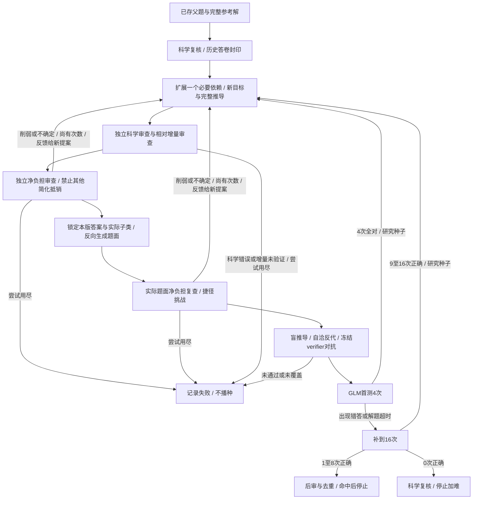

# RST逐轮生长研究实验

依据[Recursive Synthesis for Long-Horizon Terminal Tasks](https://arxiv.org/html/2608.05466v3#S4)：从验证过的父任务扩展参考解，再对齐验证器与公开任务，验证通过后重新入种子池。原论文的可执行沙箱验证不能直接等同于数学/物理证明；本实现迁移其生长顺序，不宣称复现终端任务结果或保证难度单调增加。

这是2026-10-26用户授权的独立研究模式，配置`configs/rst-curriculum.toml`，入口`scripts/run_rst_curriculum.py`，模块`src/diamond_factory/rst_curriculum.py`。默认生产配置不变，旧run保持旧协议。现有PR和被冻结的运行不自动合入、迁移或重判。

## 每轮做什么



循环受计划轮数上限约束，不会因持续过易无限运行。

1. 对已保存的候选答案、完整题解和题面重新做科学审查。旧通过资格不导入，题面完全相同的历史GLM答卷按封印和完整协议优先复用。
2. 从科学有效的父题选择一个生长操作：引入必须先发现的表示、耦合独立约束、将父题机制接入边界/全局观测量。先输出新目标、新golden、明确的required_outputs和完整推导；父题保持原样。输出合同与结果一同独立审查，不能用只有数字的gold承接“提交证明”的要求。
3. 独立审查每步推导，再由另一调用检查父机制是否保留、新依赖是否确实被目标使用、是否只是改数字/堆子问，以及最短正确路线。最多三次提案尝试，全部保存，不把内部修复计成独立题。
4. 结果锁定后生成实际题面，程序回填golden、required_outputs、来源和已核定的v3子类；不让题面作者再次决定答案或增加输出。新构造可选择同领域内的新子类，避免沿用父论文分类造成合同冲突。
5. 完成实际题面审查、隐藏桥梁审查、盲推导、自洽、反代和verifier对抗。必要定义/独立规律充分，隐藏可恢复推理。进入verifier后不改题面、golden或完整推导。
6. GLM5.2首测4次；全对则作为“过易研究种子”继续下一代，仍拒绝为交付。首轮有错或600秒解题超时才补到16；9–16/16仍可作为研究父题；1–8/16必须后审和去重才算该谱系命中，然后停止；0/16科学复核后停止加难。

科学无效、验证未覆盖、接口/格式错误和判分争议均不能入下一轮。超过轮数上限仍简单就记录未命中，不伪造成功或偷偷增加尝试。本次先做数学、物理各一条，R0加最多R1–R3；配置模型、科学与判分口径和600秒墙钟保持，未提升模型。暂不做自动降难/分叉搜索。

进入verifier前，若独立审查指出题面合同错误，可定向修题面，最多两次。修复schema只能返回question/rationale/material_key，不能改答案、完整推导、模型、子类或输出列表；新题面重新独立审查、盲解、自洽反代。错误金标、证明缺陷或不确定不能通过改问法消除。证书耗尽、已有样本、已有verifier均禁止进入这个循环。旧题面及其全部审查、修复决策和请求共同保存CAS检查点；决策落盘后崩溃可重放，不重新购买。

## 新增推理不得被其他简化抵销

仅有必要的新依赖不能证明整体变难。2026-10-26起，RST子题须通过两次独立调用：完整解提案在生成题面前审查，实际题面在科学/反代/verifier前复查。检查器位于`rst_difficulty.py`，共用提示`rst_non_regression.txt`，严格输出六项对比：

| 维度 | 重点拒绝 |
|---|---|
| 参数范围 | 全维数/全参数退化为固定数值或已给定可行域 |
| 分支覆盖 | 自行识别全部情形变为已知分支或只留一般情形 |
| 边界例外 | 删去奇异、等号、退化情形或可达到性负担 |
| 推理信息 | 题面给出原本需要求出的谱、秩、表示或其他捷径 |
| 目标义务 | 全区域/必要充分/唯一性/全局最优变为局部或单例目标 |
| 最短正确解 | 包装虽复杂，但最佳合法路线更便宜或绕过原有关键工作 |

每项均写父题负担、子题负担与具体依据，比较最佳合法解而非官方解长度。参数可以改名或隐含在新对象中，但原有负担必须在新目标中继续必要。没有某类负担可标不适用，最短解不能不适用。任一项reduced或uncertain即阻断，整体no_offset不能覆盖单项拒绝；新增商空间一步不补偿全参数分类变为单整数。纯改写也不能机械判为削弱。

拒绝和逐项反馈保存到提案历史，纳入原有最多三次尝试；下一次提案收到前次完整反馈，不额外无限重试。实际题面不通过也退回新提案身份，已有题面与失败保留，不原地更换golden。进入verifier之前的合同修复须重做实际负担审查；审批哈希绑定父快照、锁定目标/完整推导和实际题面，通用采样与导出入口同样校验。缺失、过期或仅一阶段审批均不能放行。旧冻结快照不追加或覆盖新判定。

这是“没有发现削弱”的模型门禁，不是难度单调性的证明。科学正确性、冻结verifier、真实GLM和后审仍分别执行；新门禁放行不能写成实测加难成功。

首批[真实组件验证](validation/rst-non-regression-2026-10-26.md)已完成：原固定子题两阶段拒绝、保留全参数负担的合法对照两阶段通过、谱信息泄露题面拒绝；无GLM调用，不是新难度成绩。

随后[双领域真实试跑](validation/rst-nonreg-pilot-2026-10-26.md)形成数学R1，两阶段净负担均通过，但“新增必要桥梁不是全证明最难一步”使其停在挖空标注关；物理基线停在分类覆盖。新增子题GLM0，尚无真实难度结论。

## 科学门禁与难度测量

新模式的科学、题面和挖空提示单独保存为`prompts/rst_*.txt`。科学正确性仍是硬门禁，子题相对父题的必要依赖增量也须独立审查。绝对深度不再因评审认为“熟悉、短、普通代数”提前淘汰；正确但简单是允许的起点，由真实GLM决定是否继续生长。

这不是删除旧审查中的target_depth字段后强行通过，而是按新冻结提示重新审查。实际答案泄露、可绕过所声称桥梁、缺前提或错误金标仍会阻断。有限点反代不能证明全域、唯一性或最优性，同模型独立上下文也不等于形式化证明。机器审查仍可能误杀/漏检；若未走到GLM，不声称难度提高。

## 身份、恢复与成本

- 每个候选保留root/parent/generation及新目标、答案、原始请求、修复和失败。父题的4/4或其他旧成绩不改；一个谱系命中不等于多道独立交付。
- `RstOrigin`绑定父快照、实际题面、完整题解、锁定结果、逐步审查、来源内容哈希、提示、模型配置、端点与协议代码。通用采样和导出入口也检查，不能仅凭旧通过标志绕过。
- PG保存状态和轻量检查点指针，CAS保存完整提案/历史；显式schema迁移，不新增或修改SQL迁移。SQLite仅做受控离线协议测试。中断恢复校验计划/对象，损坏拒绝；不重买已完成答卷。
- 下载、读取保持停止，只用已有材料。费用按原支付run归属，包括所有拒绝、修复和HTTP重试；历史导入不重复计费。未知usage和在途单列，不含尚未核算的VM费用。

先在专用`_test`库验证，再冻结新代码、计划、材料和价格，在个人VM独立PG/CAS运行。例如：

```bash
uv run --frozen python scripts/run_rst_curriculum.py \
  --plan work/private/rst-plan.json \
  --sources work/private/rst-sources.json \
  --rates work/private/prices.json \
  --reuse-evidence work/private/solver-history \
  --run-id rst-growth-example-v1 --directory work/rst-growth-example-v1
```

plan中的reuse_manifest_sha256必须与封印历史清单匹配。`rst-report.json`分谱系列每轮提案数、科学门禁覆盖、实际答卷/超时数、正确数、停止原因、总成本与首次命中轮数。规划上限不是成功题数，后轮缺失不是0%正确率。真实结果另存验证索引。

2026-10-26[真实试跑结果](validation/rst-growth-2026-10-26.md)：数学到R1并通过相对增量、自洽及反代，随后被verifier对照合同阻断；物理未取得完整门禁通过的父题。新增子题GLM采样0，不能据此断言难度提升或几轮命中。
